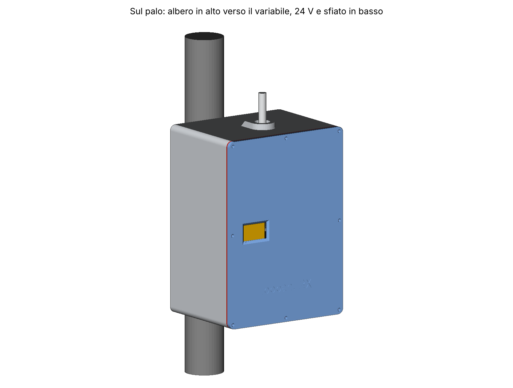
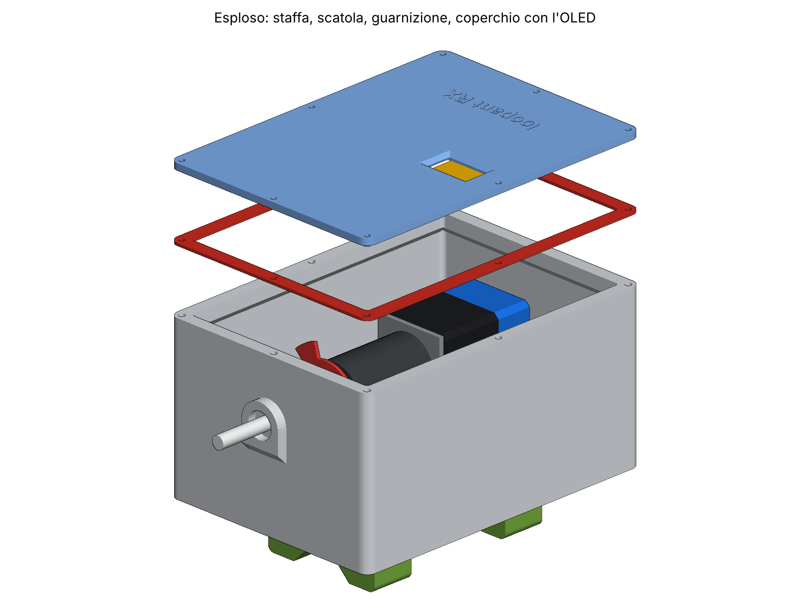
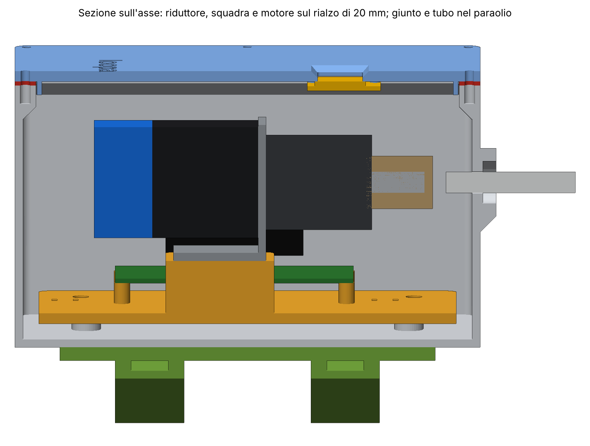

# Contenitore stampabile dell'unità antenna RX

Scatola stagna da stampare in 3D, da fissare al palo. Contiene:
- il **SERVO42D** (NEMA17 con il driver sul retro) con il **riduttore planetario 20:1**, fissati con la loro
  **squadra a 90°** alla piastra interna. La squadra sta **tra riduttore e motore**: riduttore davanti, verso la
  parete frontale, e motore dietro. La **base della squadra va verso il riduttore**; il motore, a sbalzo, appoggia
  su un supporto della piastra con una fascetta. Il gruppo è **sull'asse centrale** della scatola e su un
  **rialzo di 20 mm**: il
  variabile ha l'asse 20 mm più alto del motore, e così i due alberi restano concentrici;
- l'**elettronica** su due strisce di millefori 35×90, ai lati del motore: ESP32 DevKit 30 pin da una parte,
  SN65HVD230 e convertitore 24→5 V dall'altra;
- il **display OLED 0,96"** sotto il coperchio, dietro una finestra con vetrino.

L'albero esce **al centro della parete frontale**. Il foro è per il **tubo isolante da 8 mm**, con un paraolio, e
porta il moto al variabile da 1000 pF, che resta in una scatola separata, lontano dall'elettronica.

## Montaggio sul palo
- Palo verticale, **fondo della scatola contro il palo**, con la staffa a V e due **fascette stringitubo inox**.
- Parete frontale **in alto**: l'albero sale verso la scatola del variabile.
- Pressacavo dei 24 V e valvola di sfiato **in basso**, dove la pioggia non entra.
- Coperchio verso chi guarda. Il display è montato ruotato, con il lato lungo orizzontale e i pin in alto, e la
  scritta si legge dritta.
- La V regge pali da circa 20 a 50 mm (`PALO_D_MAX`).






Altre viste: [staffa](anteprime/staffa-palo.png), [staffa sul palo](anteprime/sul-palo-retro.png),
[interno dal retro](anteprime/montaggio-retro.png), [coperchio da dentro](anteprime/coperchio-interno.png).

## File
| File | Cosa |
|---|---|
| `contenitore.py` | Modello parametrico (CadQuery): tutte le misure sono in cima al file |
| `anteprime.py` | Immagini PNG (rasterizzatore in numpy, senza OpenGL) |
| `stl/` | Pezzi già orientati per la stampa |
| `step/` | Stessi pezzi in STEP, da aprire in FreeCAD, Fusion o nel programma di slicing |
| `anteprime/` | Immagini dell'insieme con i componenti finti |

Per rigenerare dopo aver cambiato le misure:
```bash
python3 -m venv ~/cq && ~/cq/bin/pip install cadquery matplotlib
```
```bash
~/cq/bin/python contenitore.py
```
Lo script controlla anche gli ingombri. Avvisa se motore, squadra o elettronica toccano pareti, bordo, piastra o
altri componenti, e se la staffa entra nella scatola.

## Misure (stime da verificare)
Scatola: circa **195 × 141 × 100 mm** più il coperchio (5,5 mm con la guarnizione); la borchia dell'albero sporge
6 mm. La staffa aggiunge circa 32 mm verso il palo. Interno: 189 × 135 × 97 mm. La lunghezza si calcola dal gruppo motore (150 mm) e l'altezza dal motore:
con il rialzo di 20 mm la scatola è più alta di 17 mm rispetto alla prima versione.

**Concentricità con il variabile.** L'asse del motore sta 60 mm sopra il fondo interno (63 mm sopra quello
esterno): piastra a 10 mm, rialzo di 20 mm, 30 mm della squadra. Il variabile, appoggiato sullo stesso piano, ha
l'asse 20 mm più alto del motore (`DISLIVELLO`). Se la scatola del variabile ha lo stesso fondo, la stessa piastra
e la stessa staffa, i due alberi sono allineati. Con `DISLIVELLO` negativo (motore più alto) il rialzo qui sparisce
e va sotto il variabile.

Le misure dei componenti sono **stime da verificare con il calibro** prima di stampare. Sono tutte variabili in
`contenitore.py`:

| Variabile | Valore | Cosa misurare |
|---|---|---|
| `H_ASSE` | 30 | Altezza dell'asse sopra la base della squadra (il motore ci sta sopra se è almeno 24 mm) |
| `SQUADRA_VERSO` | -1 | Da che parte va la base della squadra: -1 verso il riduttore (con l'appoggio sotto il motore), 1 sotto il motore |
| `DISLIVELLO` | 20 | Di quanto l'asse del variabile è più alto di quello del motore, appoggiati sullo stesso piano |
| `SQUADRA_BASE`, `INTERASSE_ASOLE` | 35; 30 (misura dell'utente) | Fori della base della squadra (le asole lunghe 20 mm danno margine lungo l'asse) |
| `LUNGHEZZA_GRUPPO` | 150 | Dal davanti del giunto al retro del SERVO42D (giunto, riduttore, squadra, motore): la scatola si allunga con questa misura |
| `RIDUTTORE_L`, `RIDUTTORE_D` | 52,5 (calcolato), 36 | Il riduttore prende la lunghezza che resta del gruppo; con le misure vere dei pezzi la ripartizione si corregge |
| `MOTORE_L`, `DRIVER_L` | 40, 22 | NEMA17 e guscio del SERVO42D; dietro restano 27 mm per i connettori |
| `ALBERO_L`, `GIUNTO_L`, `GIUNTO_D` | 20, 25, 20 | Albero d'uscita (8 mm) e giunto verso il tubo isolante |
| `X_GIUNTO` | 12 | Spazio tra la parete frontale interna e il davanti del giunto |
| `TUBO_ISOLANTE`, `GIOCO_FORO` | 8; 0,4 | Il foro si stampa da 8,4 mm perché i fori stampati vengono più stretti; il paraolio fa la tenuta |
| `MILLEFORI`, `MILLEFORI_FORI` | 35×90; fori a 2,5 mm dal bordo | Strisce di millefori e fori di fissaggio (viti M2 autofilettanti) |
| `OLED_FORI`, `OLED_DY_PCB`, `OLED_VETRO` | 23×23,5; 1,5; 1,8 | Interassi dei fori dell'OLED; spostamento della zona attiva; spessore del vetro |
| `PARAOLIO_D`, `PARAOLIO_P` | 16,2; 5 | Paraolio 8×16×5 |
| `PALO_D_MAX`, `TUNNEL` | 50; 14×4 | Diametro massimo del palo; passaggio della fascetta (banda fino a 12 mm) |

Tra il motore e le strisce di millefori restano circa 4 mm per lato. Se i componenti sono più larghi del
previsto, si allarga `LY`.

## Pezzi e stampa
La scatola occupa sul piatto circa 201 × 141 mm (con la borchia dell'albero): serve un piatto da almeno 220 mm.

| Pezzo | Materiale | Orientamento | Note |
|---|---|---|---|
| `scatola.stl` | **ASA** (o PETG) | Fondo sul piatto | Bordo interno smussato a 45° e borchia con mento a 45°: nessun supporto. 4 perimetri, 25–30 % di riempimento |
| `coperchio.stl` | ASA o PETG | Faccia esterna sul piatto (la scritta è incisa sotto) | Nessun supporto |
| `piastra.stl` | PETG | Piatta, rialzo verso l'alto | 3 perimetri, 30 % di riempimento (rialzo e appoggio del motore sono pieni) |
| `staffa-palo.stl` | **ASA** o PETG | Faccia verso la scatola sul piatto | Le V sono aperte verso l'alto e i passaggi delle fascette sono ponti da 14 mm: nessun supporto. 5 perimetri, 40 % di riempimento |
| `guarnizione.stl` | **TPU 85A–95A** | Piatta | In alternativa: foglio di silicone o EPDM da 1,5 mm, ritagliato usando lo STL come dima |

Il PLA non va bene sul balcone: al sole si deforma e con i raggi UV diventa fragile. Con il PETG conviene una
mano di vernice.

## Materiale
- 8 inserti a caldo M3 (Ø 4,0 mm, lunghi 5–6 mm) per il coperchio e 4 per la piastra; 8 viti M3×12 e 4 viti M3×8.
- 4 inserti a caldo **M4** nel fondo per la staffa. I fori sono ciechi e il fondo resta chiuso. 4 viti M4×8 a
  testa cilindrica.
- 2 **fascette stringitubo inox** (banda da 9–12 mm) adatte al diametro del palo.
- 2 viti M4×20 con rondelle e dadi per la squadra (asole a 30 mm di interasse): la vite entra dal basso, con testa
  e rondella nell'asola larga sotto la piastra (sotto la squadra restano 8 mm di materiale), e il dado si stringe
  sopra la squadra.
- Una fascetta di plastica che tiene il motore sul suo appoggio (fessure nella piastra ai lati).
- 8 viti M2×6 autofilettanti per le due strisce di millefori e 4 per l'OLED.
- 2 pressacavi **PG7**: 24 V in basso e cavo dei finecorsa in alto, verso la scatola del variabile. Quello in alto
  va stretto bene: è rivolto verso la pioggia.
- Valvola di sfiato a membrana **M12×1,5**, in basso, più un sacchetto di silica gel.
- **Paraolio 8×16×5** nella borchia frontale, con il labbro verso l'esterno; un velo di grasso al silicone sul
  tubo isolante.
- Vetrino in plexiglass 31×17 mm, spesso 1,5 mm, incollato da dentro con silicone neutro.

## Montaggio
1. Inserti a caldo nel bordo (8), nelle colonnine del fondo (4) e, da fuori, nei rinforzi del fondo per la
   staffa (4).
2. Riduttore avvitato davanti alla squadra e motore dietro, con l'albero nel foro della squadra. Squadra sul rialzo
   della piastra, con la base sotto il riduttore, nelle asole; fascetta attorno al motore e al suo appoggio;
   strisce di millefori sui distanziali.
3. Piastra nella scatola. L'apertura del bordo è 179×125 mm e la piastra 177×123 mm.
4. Giunto sull'albero del riduttore. Tubo isolante infilato dall'esterno attraverso il paraolio, fino al giunto.
5. Cavi nei PG7 e fascette nelle fessure della piastra. OLED sulle colonnine del coperchio, vetrino incollato.
6. Coperchio con la guarnizione; viti strette in modo uniforme, a croce.
7. Staffa avvitata al fondo. Fascette infilate nei passaggi dei blocchi a V e strette attorno al palo.

## Da verificare
- Il dislivello di 20 mm misurato con variabile e motore appoggiati sullo stesso piano; poi, con tutto montato,
  che il tubo isolante giri senza forzare (un piccolo disassamento lo assorbono i giunti).
- Tutte le misure della tabella sopra, prima della stampa definitiva. Si può stampare prima solo la piastra
  per provare la squadra e le millefori.
- Tenuta reale della guarnizione in TPU (prova con la doccia) e del paraolio sul tubo isolante, che con il palo
  verticale è rivolto verso l'alto: la scatola del variabile, montata subito sopra, gli fa da tettoia.
- Tenuta degli inserti M4 nel fondo con il peso del motore e il vento: eventualmente staffa più larga o
  inserti più lunghi.
- Disturbo dell'OLED sui 40 e 20 m: è un punto aperto anche del firmware.
- Temperatura al sole d'estate. Se serve, coperchio chiaro o tettuccio.
