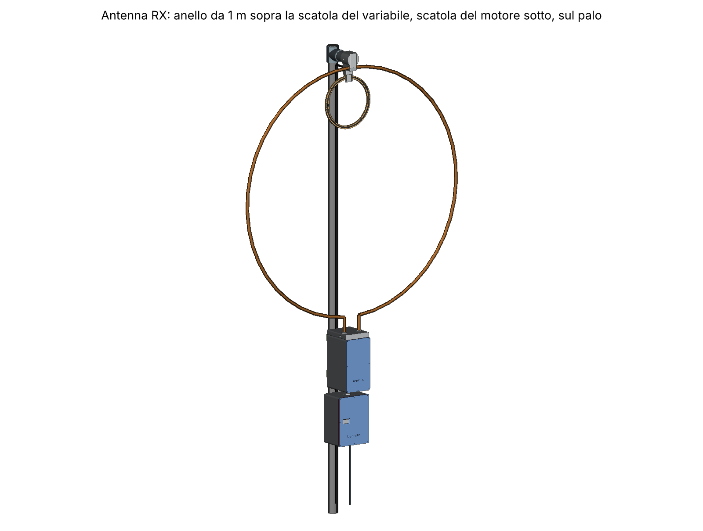
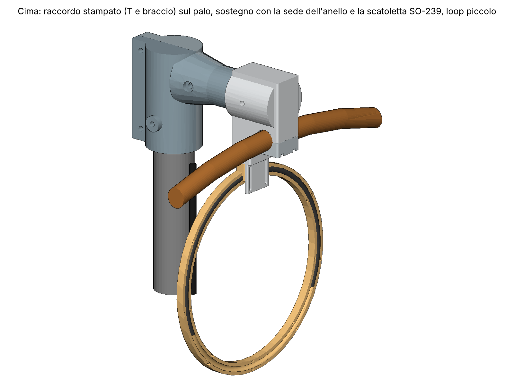
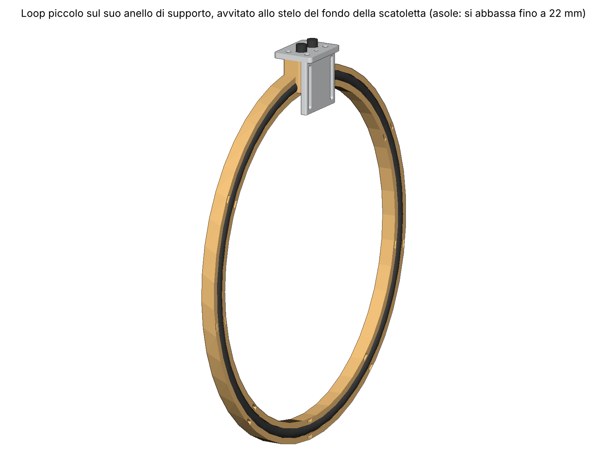
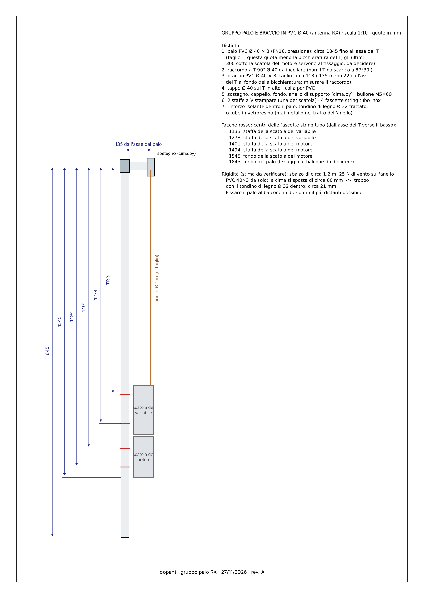
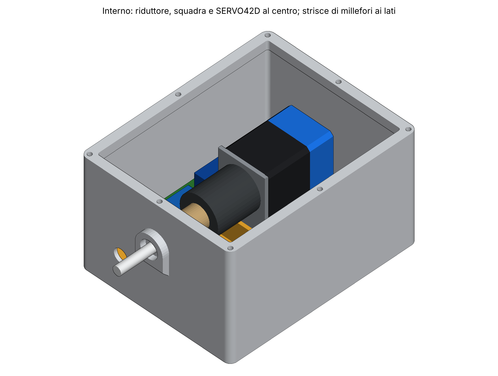
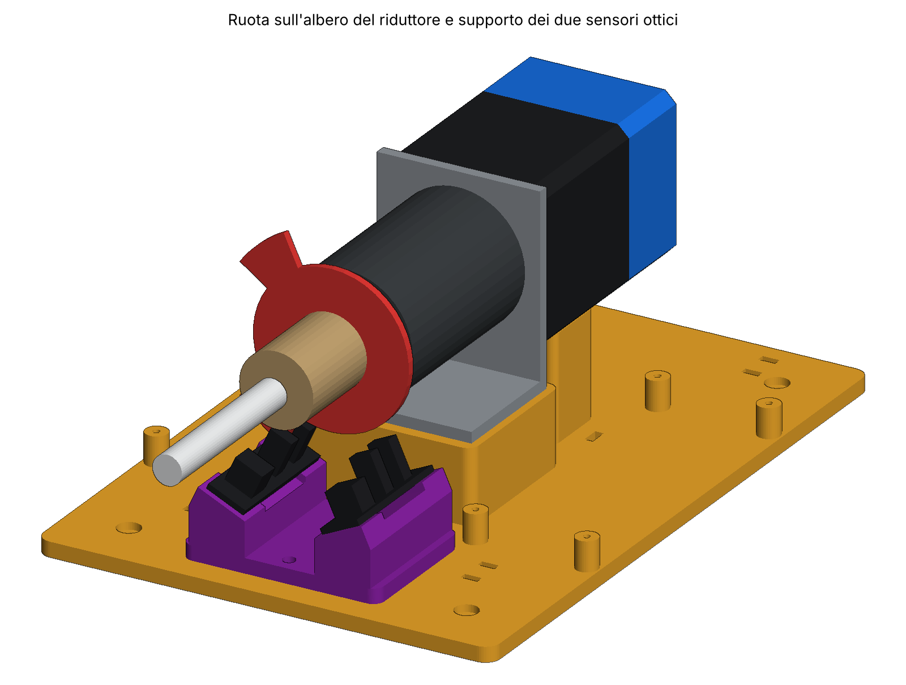
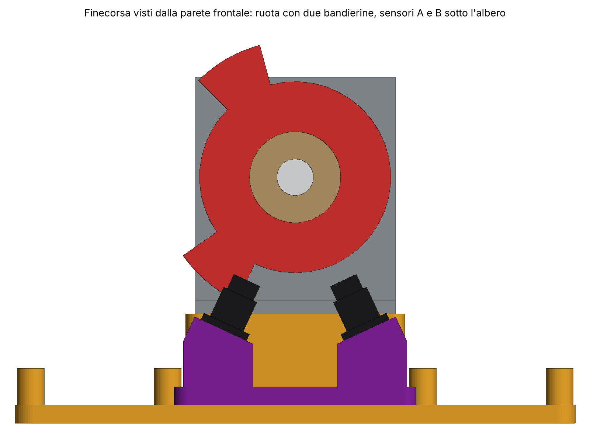
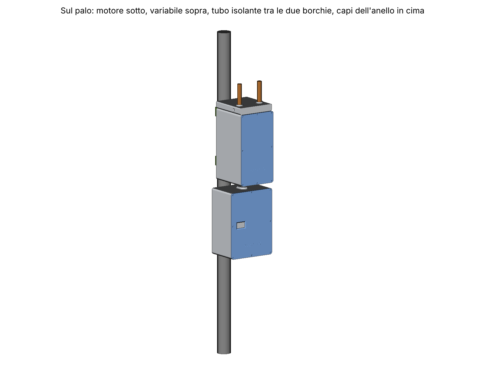
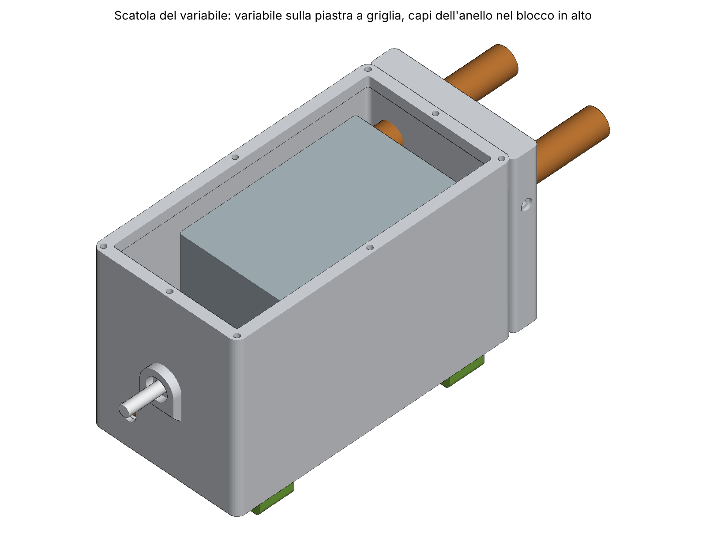
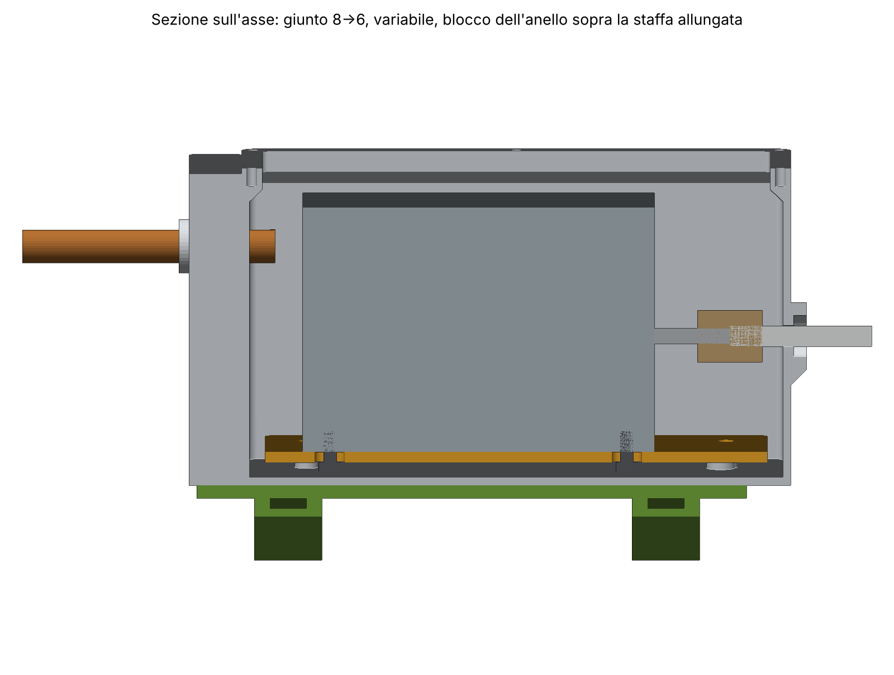

# Contenitori stampabili dell'antenna RX

Due scatole sullo stesso palo: **motore ed elettronica** (sotto) e **variabile** (sopra, regge l'anello di rame).
La seconda è descritta in fondo, in «Scatola del variabile».

## Assieme dell'antenna
Script: `assieme.py` → immagini `anteprime/assieme-*.png` e `step/assieme.step` (tutto l'insieme con i colori, da
aprire in FreeCAD o Fusion per guardarlo).



Altre viste: [di fronte](anteprime/assieme-fronte.png), [di lato](anteprime/assieme-lato.png), [cima](anteprime/assieme-cima.png),
[le due scatole](anteprime/assieme-scatole.png).

- Dal basso: scatola del motore (borchia in alto), tubo isolante, scatola del variabile (borchia in basso), anello
  di rame da 1 m con i capi nel blocco in alto. Altezza dal fondo della scatola del motore alla cima dell'anello:
  circa 1,52 m; centro dell'anello circa 1,01 m sopra il fondo della scatola del motore.
- Piano dell'anello a circa 128 mm dall'asse del palo.
- **Alimentazione**: il coassiale va solo al **loop di accoppiamento** (cerchio piccolo da 20 cm, circa 1/5 del
  diametro, in cima dentro l'anello). L'anello grande non ha collegamenti al cavo: con il variabile è un circuito
  risonante e scambia il segnale con il loop piccolo per accoppiamento magnetico, come un trasformatore.
- **Cima** (proposta, `cima.py`): braccio in **PVC Ø 40** unito al palo in PVC da 40 con un **raccordo a T** da
  incollare; in punta il **sostegno** stampato (bullone M5 di traverso nel braccio), con la sede della cima
  dell'anello chiusa dal **cappello** (4 viti M3 in inserti a caldo) e, dietro l'anello, la scatoletta con l'**SO-239**
  rivolto verso il palo; il **fondo** della scatoletta (4 viti M3) ha i due fori da 6,6 mm per i capi del loop
  piccolo (tubetto di rame da 6 mm o RG-58), che sta 21 mm dietro il piano dell'anello. Coassiale lungo il palo;
  cavo dei 24 V dal PG7 in basso.



| Pezzo | Materiale | Orientamento | Note |
|---|---|---|---|
| `cima-sostegno.stl` | ASA o PETG | Faccia verso il palo sul piatto (sede del braccio verticale) | 5 perimetri, 40 %; nessun supporto |
| `cima-cappello.stl` | ASA o PETG | Sede verso l'alto | |
| `cima-fondo.stl` | ASA o PETG | Piatto, stelo verso l'alto | Stelo con 2 asole verticali per regolare il loop piccolo |
| `cima-anello-accoppiamento.stl` | **ASA** o PETG | Piatto, gola verso l'alto | Ø 212 × 11 mm, piatto da almeno 225 mm; 4 perimetri, 40 %; nessun supporto |

Viti: 1 bullone M5×60 con dado (sostegno e braccio, il PVC va forato da 5,5 mm), 4 M3×12 per il cappello, 4 M3×8
per il fondo, 8 inserti a caldo M3, SO-239 con 4 viti M3×10 e dadi; silicone sui fori del fondo; 2 viti M3×20 con
rondelle e dadi per la linguetta dell'anello di supporto sullo stelo; 7 fascette da 2,5 mm per il conduttore.

**Loop piccolo** (`cima-anello-accoppiamento`): il conduttore (tubetto di rame Ø 6 o RG-58) entra a scatto nella gola
sul davanti dell'anello di supporto ed è fermato con le fascette nelle 7 coppie di fessure; in cima i due capi salgono
nei canali della linguetta e nei fori del fondo fino all'SO-239. La linguetta si avvita allo stelo del fondo con 2
viti M3 nelle asole: nella posizione più alta il loop piccolo è a circa 35 mm dall'anello grande e si può abbassare
fino a 22 mm per cercare il ROS minimo (lasciare i capi un po' più lunghi dentro la scatoletta).


- **Palo**: nel tratto che passa dietro l'anello conviene un palo **non metallico** (vetroresina o PVC): un tubo
  di metallo parallelo all'anello e così vicino ne peggiora il rendimento e la sintonia (da verificare con il
  NanoVNA).

## Gruppo palo e braccio in PVC Ø 40
Tavola: [`gruppo-palo.pdf`](gruppo-palo.pdf) (script `gruppo_palo.py`, quote prese dall'assieme).



- Palo PVC Ø 40 × 3 (PN16) di circa 1845 mm fino all'asse del raccordo a T, braccio di 135 mm dall'asse del palo
  (taglio circa 113, da adattare alla bicchieratura del T), raccordo a T a 90° da incollare, tappo in cima.
- Centri delle fascette stringitubo, dall'asse del T verso il basso: 1133 e 1278 (scatola del variabile), 1401 e
  1494 (scatola del motore); fondo della scatola del motore a 1545.
- **Rigidità (stima da verificare)**: con circa 1,2 m di sbalzo e 25 N di vento sull'anello, il PVC 40×3 da solo
  flette di circa 80 mm in cima; con un tondino di legno Ø 32 dentro circa 21 mm. Rinforzo isolante dentro il palo
  (legno o vetroresina, mai metallo) e fissaggio al balcone in due punti distanti.

## Scatola del motore

Scatola stagna da stampare in 3D, da fissare al palo. Contiene:
- il **SERVO42D** (NEMA17 con il driver sul retro) con il **riduttore planetario 20:1**, fissati con la loro
  **squadra a 90°** alla piastra interna. La squadra sta **tra riduttore e motore**: riduttore davanti, verso la
  parete frontale, e motore dietro. La **base della squadra va verso il riduttore**; il motore, a sbalzo, appoggia
  su un supporto della piastra con una fascetta. Il gruppo è **sull'asse centrale** della scatola e su un
  **rialzo di 20 mm** (più 2 mm di spessore sotto la squadra): il
  variabile ha l'asse 20 mm più alto del motore, e così i due alberi restano concentrici;
- l'**elettronica** su due strisce di millefori 35×90, ai lati del motore: ESP32 DevKit 30 pin da una parte,
  SN65HVD230 e convertitore 24→5 V dall'altra;
- il **display OLED 0,96"** sotto il coperchio, dietro una finestra con vetrino;
- i **due finecorsa ottici** (forcella, schedina 35 × 11 mm, fori a 28 mm) su un supporto avvitato alla piastra,
  sotto l'albero, e la **ruota con due bandierine** sull'albero d'uscita del riduttore.

L'albero esce **al centro della parete frontale**. Il foro è per il **tubo isolante da 8 mm**, con un paraolio, e
porta il moto al variabile da 1000 pF, che resta in una scatola separata, lontano dall'elettronica.

## Montaggio sul palo
- Palo verticale, **fondo della scatola contro il palo**, con la staffa a V e due **fascette stringitubo inox**.
- Parete frontale **in alto**: l'albero sale verso la scatola del variabile.
- Pressacavo dei 24 V e valvola di sfiato **in basso**, dove la pioggia non entra.
- Coperchio verso chi guarda. Il display è montato ruotato, con il lato lungo orizzontale e i pin in alto, e la
  scritta si legge dritta.
- La V regge pali da circa 20 a 50 mm (`PALO_D_MAX`).





## Finecorsa
Il variabile ha un'escursione di **190°** da fermo a fermo (`ESCURSIONE`), quindi servono due finecorsa: uno per
capo. Scattano 5° prima di ciascun fermo (`MARGINE`), cioè a 180° l'uno dall'altro (`CORSA`).

- **Ruota** (`ruota-finecorsa.stl`): va sull'albero d'uscita del riduttore, tra il riduttore e il giunto, con il
  disco verso il giunto. Si blocca con un grano M3 e un dado M3 infilato nella sua sede del mozzo. Ha due
  bandierine larghe 30°, alla stessa distanza dall'asse.
- **Sensori**: tutti e due sotto l'albero, a 50° l'uno dall'altro (`SENSORE_A` 295°, `SENSORE_B` 245°), con la
  forcella verso la ruota. La prima bandierina entra nel sensore A allo zero; la seconda entra nel sensore B dopo
  `CORSA` = 180°. Nessuna delle due passa mai sull'altro sensore: lo script lo controlla a passi di 5° su tutta la
  corsa, con 20° di extracorsa a ogni capo.
- **Verso di rotazione**: se lo zero si raggiunge girando nell'altro senso, si stampa
  `ruota-finecorsa-specchiata.stl`; il supporto è lo stesso.
- **Messa a punto**: variabile contro il fermo del minimo e poi indietro di 5°; ruota girata finché la prima
  bandierina entra nel sensore A, e grano stretto. Il sensore B scatta 180° dopo, 5° prima dell'altro fermo. Se
  l'escursione vera del variabile è diversa, si cambia `ESCURSIONE` e si ristampa solo la ruota (pochi minuti).
- **Uscita dei sensori**: alta quando la bandierina interrompe la luce. Sul SERVO42D vanno impostati di
  conseguenza il livello dei finecorsa e il verso dell'azzeramento nel menu (da verificare).
- Il pressacavo dei finecorsa in alto non serve più: i sensori sono dentro la scatola.




Altre viste: [staffa](anteprime/staffa-palo.png), [staffa sul palo](anteprime/sul-palo-retro.png),
[interno dal retro](anteprime/montaggio-retro.png), [coperchio da dentro](anteprime/coperchio-interno.png).

## File
| File | Cosa |
|---|---|
| `contenitore.py` | Modello parametrico (CadQuery): tutte le misure sono in cima al file |
| `anteprime.py` | Immagini PNG (rasterizzatore in numpy, senza OpenGL) |
| `stl/` | Pezzi già orientati per la stampa |
| `step/` | Stessi pezzi in STEP, da aprire in FreeCAD, Fusion o nel programma di slicing |
| `anteprime/` | Immagini dell'insieme con i componenti finti |

Per rigenerare dopo aver cambiato le misure:
```bash
python3 -m venv ~/cq && ~/cq/bin/pip install cadquery matplotlib
```
```bash
~/cq/bin/python contenitore.py
```
Lo script controlla anche gli ingombri. Avvisa se motore, squadra o elettronica toccano pareti, bordo, piastra o
altri componenti, e se la staffa entra nella scatola.

## Misure (stime da verificare)
Scatola: circa **195 × 141 × 100 mm** più il coperchio (5,5 mm con la guarnizione); la borchia dell'albero sporge
6 mm. La staffa aggiunge circa 32 mm verso il palo. Interno: 189 × 135 × 97 mm. La lunghezza si calcola dal gruppo motore (150 mm) e l'altezza dal motore:


**Concentricità con il variabile.** L'asse comune delle due scatole sta **60 mm** sopra il fondo interno
(`ASSE_Z`, 63 mm sopra quello esterno), come nella scatola e nella piastra già stampate. Misura: dalla faccia di
sotto della piastra al centro del perno del riduttore 52 mm (`QUOTA_PIASTRA_ASSE`); con le colonnine da 6 mm il
perno sta a 58 mm, quindi sotto la base della squadra va uno **spessore di 2 mm** (rondelle o lamierino,
`SPESSORE_SQUADRA`) per centrarlo nel foro della borchia. Prova semplice: il tubo isolante deve entrare dritto
nel paraolio e nel giunto senza forzare. Il variabile ha l'asse 45 mm sopra la sua base (`H_ASSE_VARIABILE`):
nella sua scatola la piastra sta su colonnine da 11 mm, così la base è a 15 mm e l'asse di nuovo a 60.

Le misure dei componenti sono **stime da verificare con il calibro** prima di stampare. Sono tutte variabili in
`contenitore.py`:

| Variabile | Valore | Cosa misurare |
|---|---|---|
| `QUOTA_PIASTRA_ASSE`, `H_ASSE_VARIABILE` | 52; 45 (misure dell'utente) | Dalla faccia di sotto della piastra del motore al perno; dalla base del variabile al perno. Lo spessore sotto la squadra (2 mm) si ricava |
| `SQUADRA_VERSO` | -1 | Da che parte va la base della squadra: -1 verso il riduttore (con l'appoggio sotto il motore), 1 sotto il motore |
| `DISLIVELLO` | 20 | Di quanto l'asse del variabile è più alto di quello del motore, appoggiati sullo stesso piano |
| `SQUADRA_BASE`, `INTERASSE_ASOLE` | 35; 30 (misura dell'utente) | Fori della base della squadra (le asole lunghe 20 mm danno margine lungo l'asse) |
| `LUNGHEZZA_GRUPPO` | 150 | Dal davanti del giunto al retro del SERVO42D (giunto, riduttore, squadra, motore): la scatola si allunga con questa misura |
| `RIDUTTORE_L`, `RIDUTTORE_D` | 52,5 (calcolato), 36 | Il riduttore prende la lunghezza che resta del gruppo; con le misure vere dei pezzi la ripartizione si corregge |
| `MOTORE_L`, `DRIVER_L` | 40, 22 | NEMA17 e guscio del SERVO42D; dietro restano 27 mm per i connettori |
| `ALBERO_L`, `GIUNTO_L`, `GIUNTO_D` | 20, 25, 20 | Albero d'uscita (8 mm) e giunto verso il tubo isolante |
| `X_GIUNTO` | 12 | Spazio tra la parete frontale interna e il davanti del giunto |
| `TUBO_ISOLANTE`, `GIOCO_FORO` | 8; 0,4 | Il foro si stampa da 8,4 mm perché i fori stampati vengono più stretti; il paraolio fa la tenuta |
| `MILLEFORI`, `MILLEFORI_FORI` | 35×90; fori a 2,5 mm dal bordo | Strisce di millefori e fori di fissaggio (viti M2 autofilettanti) |
| `OLED_FORI`, `OLED_DY_PCB`, `OLED_VETRO` | 23×23,5; 1,5; 1,8 | Interassi dei fori dell'OLED; spostamento della zona attiva; spessore del vetro |
| `PARAOLIO_D`, `PARAOLIO_P` | 16,2; 5 | Paraolio 8×16×5 |
| `PALO_D_MAX`, `TUNNEL` | 50; 14×4 | Diametro massimo del palo; passaggio della fascetta (banda fino a 12 mm) |

Tra il motore e le strisce di millefori restano circa 4 mm per lato. Se i componenti sono più larghi del
previsto, si allarga `LY`.

## Pezzi e stampa
La scatola occupa sul piatto circa 201 × 141 mm (con la borchia dell'albero): serve un piatto da almeno 220 mm.

| Pezzo | Materiale | Orientamento | Note |
|---|---|---|---|
| `scatola.stl` | **ASA** (o PETG) | Fondo sul piatto | Bordo interno smussato a 45° e borchia con mento a 45°: nessun supporto. 4 perimetri, 25–30 % di riempimento |
| `coperchio.stl` | ASA o PETG | Faccia esterna sul piatto (la scritta è incisa sotto) | Nessun supporto |
| `piastra.stl` | PETG | Piatta, rialzo verso l'alto | 3 perimetri, 30 % di riempimento (rialzo e appoggio del motore sono pieni) |
| `ruota-finecorsa.stl` | PETG (meglio scuro e opaco: le bandierine devono fermare la luce) | Disco sul piatto, mozzo in alto | Nessun supporto; 100 % di riempimento |
| `ruota-finecorsa-specchiata.stl` | come sopra | come sopra | Solo se lo zero è nell'altro verso |
| `supporto-finecorsa.stl` | PETG | Base sul piatto | Nessun supporto |
| `staffa-palo.stl` | **ASA** o PETG | Faccia verso la scatola sul piatto | Le V sono aperte verso l'alto e i passaggi delle fascette sono ponti da 14 mm: nessun supporto. 5 perimetri, 40 % di riempimento |
| `guarnizione.stl` | **TPU 85A–95A** | Piatta | In alternativa: foglio di silicone o EPDM da 1,5 mm, ritagliato usando lo STL come dima |
| `vetrino-oled.stl` | PETG **trasparente** | Piatto | Vetrino della finestra dell'OLED, 30,6×16,6×1,5 mm. Stampato è traslucido: si legge, ma meno nitido del plexiglass. Serve anche come dima per tagliare il plexiglass |

Il PLA non va bene sul balcone: al sole si deforma e con i raggi UV diventa fragile. Con il PETG conviene una
mano di vernice.

## Viti e inserti
Viti in **acciaio inox A2** (sono all'aperto). Le lunghezze sono calcolate sui fori del modello.

| Dove | Quante | Vite | Si avvita in | Note |
|---|---|---|---|---|
| Coperchio | 8 | **M3×12** testa cilindrica o bombata | inserti a caldo M3 nel bordo della scatola | coperchio 4 mm + guarnizione 1,5 mm, poi 6,5 mm nell'inserto |
| Piastra sulle colonnine | 4 | **M3×6 testa bombata** (ISO 7380) | inserti a caldo M3 nelle colonnine del fondo | testa nell'incasso da 2 mm della piastra |
| Squadra sulla piastra | 2 | **M4×20** + 2 rondelle + dado (meglio autobloccante) | dado sopra la squadra | vite dal basso, testa e rondella nell'asola larga sotto la piastra |
| Staffa sul fondo | 4 | **M4×8 testa bombata** (ISO 7380) | inserti a caldo M4 nel fondo, da fuori | testa nell'incasso della staffa dal lato del palo; una testa cilindrica sporgerebbe di 1 mm |
| Millefori sui distanziali | 8 | **M2×6 autofilettanti** (per plastica) | foro da 1,8 mm nei distanziali | vanno bene fino a M2×8 |
| OLED sulle colonnine del coperchio | 4 | **M2×5 autofilettanti** | foro da 1,7 mm nelle colonnine | non più lunghe: il foro è profondo 4,3 mm e una M2×6 arriverebbe in fondo |
| Sensori ottici sul supporto | 4 | **M3×6** testa cilindrica | inserti a caldo M3 nel supporto | |
| Supporto dei finecorsa sulla piastra | 2 | **M3×12** + rondella + dado | dado sotto la piastra | |
| Ruota sull'albero | 1 | **grano M3×6** + dado M3 | dado nella sede del mozzo | sull'eventuale spianatura dell'albero |
| Riduttore e motore sulla squadra | — | quelle in dotazione | squadra | NEMA17: M3; riduttore: secondo la flangia |

Inserti a caldo: **16 M3** (Ø foro 4,0 mm, lunghi 5–6 mm: 8 nel bordo, 4 nelle colonnine, 4 nel supporto dei finecorsa) e **4 M4** (Ø foro
5,6 mm, lunghi 6–8 mm, nel fondo da fuori). I fori M4 sono ciechi: dentro la scatola ci sono 4 rinforzi alti 5 mm
e il fondo resta chiuso.

## Altro materiale
- 2 **fascette stringitubo inox** (banda da 9–12 mm) adatte al diametro del palo.
- Una fascetta di plastica che tiene il motore sul suo appoggio (fessure nella piastra ai lati).
- 1 pressacavo **PG7** per i 24 V, in basso.
- Valvola di sfiato a membrana **M12×1,5**, in basso, più un sacchetto di silica gel.
- **Paraolio 8×16×5** nella borchia frontale, con il labbro verso l'esterno; un velo di grasso al silicone sul
  tubo isolante.
- Vetrino 30,6×16,6 mm, spesso 1,5 mm, incollato da dentro nella sua sede con silicone neutro: meglio in plexiglass
  (più nitido), oppure `vetrino-oled.stl` stampato in PETG trasparente. Il buco grande che si vede da fuori è lo
  smusso a 45° della finestra; la tenuta la fa il vetrino ([immagine](anteprime/finestra-oled.png)).

## Montaggio
1. Inserti a caldo nel bordo (8), nelle colonnine del fondo (4) e, da fuori, nei rinforzi del fondo per la
   staffa (4).
2. Riduttore avvitato davanti alla squadra e motore dietro, con l'albero nel foro della squadra. Squadra sul rialzo
   della piastra, con la base sotto il riduttore, nelle asole; fascetta attorno al motore e al suo appoggio;
   strisce di millefori sui distanziali.
3. Piastra nella scatola. L'apertura del bordo è 179×125 mm e la piastra 177×123 mm.
4. Giunto sull'albero del riduttore. Tubo isolante infilato dall'esterno attraverso il paraolio, fino al giunto.
5. Ruota sull'albero e supporto dei finecorsa sulla piastra (vedi «Finecorsa»). Cavo dei 24 V nel PG7 e fascette nelle fessure della piastra. Vetrino incollato nella sua sede da dentro, poi OLED sulle colonnine del coperchio: il vetro del display
   preme sul vetrino.
6. Coperchio con la guarnizione; viti strette in modo uniforme, a croce.
7. Staffa appoggiata al fondo e fissata con le 4 viti M4×8 negli inserti, dal lato del palo: le viti stanno fuori
   dai blocchi a V e si raggiungono anche con la scatola montata. Poi le fascette nei passaggi dei blocchi,
   strette attorno al palo ([immagine](anteprime/staffa-montaggio.png)).

## Da verificare
- Il dislivello di 20 mm misurato con variabile e motore appoggiati sullo stesso piano; poi, con tutto montato,
  che il tubo isolante giri senza forzare (un piccolo disassamento lo assorbono i giunti).
- Tutte le misure della tabella sopra, prima della stampa definitiva. Si può stampare prima solo la piastra
  per provare la squadra e le millefori.
- Tenuta reale della guarnizione in TPU (prova con la doccia) e del paraolio sul tubo isolante, che con il palo
  verticale è rivolto verso l'alto: la scatola del variabile, montata subito sopra, gli fa da tettoia.
- Tenuta degli inserti M4 nel fondo con il peso del motore e il vento: eventualmente staffa più larga o
  inserti più lunghi.
- Disturbo dell'OLED sui 40 e 20 m: è un punto aperto anche del firmware.
- Temperatura al sole d'estate. Se serve, coperchio chiaro o tettuccio.

## Scatola del variabile
Script: `scatola_variabile.py` (usa le parti comuni di `contenitore.py`). Pezzi: `stl/variabile-*.stl`.





- **Variabile**: 1000 pF (20–1000 pF), corpo 135 × 83 × 95 mm, perno di comando di circa 29 mm, 600 g (misure
  dell'utente). Ha 4 fori filettati **M5** sulle linguette delle fiancate: 114 mm lungo l'asse, 97 mm tra le linguette di sotto
  e quelle di sopra. Si usano le **due di sotto**: due viti M5 dal basso attraverso le **asole** della piastra
  (6 mm di gioco lungo l'asse), testa e rondella nello spazio di 6 mm sotto la piastra. Se i tiranti in basso del
  variabile sporgono più giù delle linguette, si alza `ALZO_LINGUETTE` (rialzi sotto le linguette) o si mettono
  rondelle.
- **Concentricità**: stesso fondo, stessa piastra e stessa staffa della scatola del motore; l'asse del variabile
  sta 45 mm sopra la sua base e la piastra su colonnine da 11 mm, quindi a 60 mm dal fondo interno, come il motore. Sul palo le due scatole hanno la borchia una verso l'altra; tra le due borchie circa 12 mm.
- **Tubo isolante**: giunto 8→6 sul perno del variabile; il tubo isolante lungo circa 59 mm più lo spazio tra le
  borchie (circa 71 mm con 12 mm), con un paraolio 8×16×5 in ciascuna borchia.
- **Anello**: i due capi del tubo di rame (1/2", parametro `TUBO_ANELLO`; 70 mm tra i capi, `INTERASSE_CAPI`)
  entrano dall'alto in un **blocco pieno spesso 20 mm** che fa da parete superiore. Ogni capo ha un collare e una
  svasatura per il silicone, ed è bloccato da una **vite M4 di traverso** che entra dal fianco, attraversa il tubo
  forato da 4,2 mm e filetta la plastica oltre: una vite per capo, così i due capi restano isolati tra loro.
- **Peso e vento**: la staffa del palo si allunga sotto il blocco e prende 2 viti M4 in più (inserti nel blocco),
  con un blocco a V vicino all'anello: il carico dell'anello va dritto al palo. Stima da verificare: anello 1 m
  in tubo da 1/2" circa 1 kg, più la spinta del vento.
- **Sfiato**: valvola M12 sulla parete della borchia, che sul palo è in basso. Nessun pressacavo: dentro ci sono
  solo variabile e piattine.
- **Ingombro**: circa 241 × 111 × 123 mm con la borchia e il blocco: serve un piatto da almeno 250 mm. Se non
  basta, si accorcia il perno del variabile (da 29 a 20 mm si risparmiano 9 mm, parametro `VAR_ALBERO_L`).

### Collegamento dei capi dell'anello
Dentro la scatola ogni capo sporge solo 10 mm (subito dopo c'è il variabile): non si schiaccia e non si fora.
- **Al banco, prima di montare**: taglio di 12–15 mm nella punta del tubo con il seghetto (lama da 1 mm), dentro
  una **piattina di rame 12 × 1 mm** lunga circa 60 mm, saldata a stagno tutto attorno (cannello o saldatore
  grosso); foro da 4–5 mm all'altro capo della piattina.
- Il tubo con la piattina si infila da fuori nel blocco: la piattina larga 12 mm passa nel foro da 13,1 mm. Poi
  la vite M4 di traverso (inox o ottone) blocca il tubo, più indietro della saldatura.
- **Variabile a farfalla** (due statori isolati tra loro, da provare col tester): i due capi ai due statori,
  rotore libero, nessuna corrente nei cuscinetti.
- **Un solo statore** (sembra così dalle foto): un capo al perno dello statore, l'altro al telaio sulla linguetta
  in alto della fiancata posteriore. La corrente passa dai cuscinetti: in ricezione va bene; se ci sono
  scricchiolii quando gira, una spazzola o una treccia sul perno.
- Dado e rosetta dentata su ogni morsetto; silicone neutro attorno ai capi, nella svasatura del collare.

| Pezzo | Materiale | Orientamento | Note |
|---|---|---|---|
| `variabile-scatola.stl` | **ASA** o PETG | Fondo sul piatto | 6 perimetri, 40 % di riempimento: il blocco dell'anello deve essere robusto |
| `variabile-coperchio.stl` | ASA o PETG | Faccia esterna sul piatto | |
| `variabile-piastra.stl` | PETG | Piatta | |
| `variabile-staffa-palo.stl` | ASA o PETG | Faccia verso la scatola sul piatto | 5 perimetri, 40 % |
| `variabile-guarnizione.stl` | TPU | Piatta | |

Viti: 8 M3×12 per il coperchio (inserti M3 nel bordo), 4 M3×6 a testa bombata per la piastra (inserti nelle
colonnine), 4 M4×8 a testa bombata per la staffa (inserti M4 nel fondo e nel blocco), 2 M4×40 inox o ottone per i
capi dell'anello (dal fianco, attraverso il tubo), 2 viti M5×12 con rondella per il variabile (acciaio inox o nylon). Giunto 8→6, paraolio 8×16×5,
valvola di sfiato M12, silicone neutro sui capi.

Da verificare: diametro del perno del variabile (6 mm?), che i fori M5 di sotto siano al centro della larghezza, se i tiranti sporgono sotto le linguette, morsetti degli
statori rispetto ai capi (piattine), peso reale dell'anello e tenuta delle viti nei capi.
